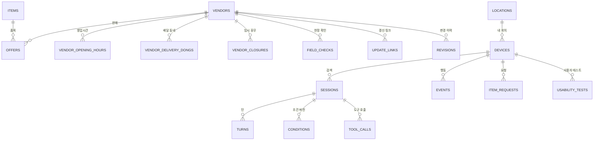

# 천하장사 · DB 아키텍처 v0.6

> 2026-11-04 작성 · 송민혁 · 로컬 문서(저장소에 올리지 않음)
> 원천: `개발기획서.md` 3절(데이터 개체 E-01~E-15)·4절(규칙 R)·5절(워크플로우 WF), `API명세서.md`.
> 단계 표시: **[MVP]** 11/11까지 · **[다음]** 발표 이후.

---

## 0. 한눈에 보기

| 항목 | 결정 |
|---|---|
| 저장소 두 곳 | ① 앱 안 데이터 파일(`data/*.json`): 판매처·판매 정보·품목·위치 [MVP] ② 내 Supabase(Postgres): 기기·대화·조건·도구 호출·행동·요청 기록 [MVP] |
| [다음] | 판매처·판매 정보·품목·위치를 같은 Supabase로 옮기고, 운영자·판매처 갱신 관련 표를 더한다 |
| 접근 방식 | 앱은 DB에 직접 붙지 않는다. **모든 읽기·쓰기는 서버 API를 거친다.** 서버만 서비스 키로 접속 |
| 보안 | 모든 표에 RLS(행 단위 접근 제어)를 켜고 공개 정책을 두지 않는다. 브라우저 공개 키로는 아무것도 읽거나 쓸 수 없다 |
| 스키마 | `chj`(천하장사) 한 스키마. Supabase 기본 `public`과 분리 |
| 이름 규칙 | 표·칸은 영어 소문자와 밑줄(snake_case). 표 이름은 복수형 |
| 식별자 | 기기·세션·기록은 uuid. 판매처·품목·위치는 사람이 읽는 문자열 id(`v_001`, `item_lettuce`, `loc_ajou_main`) |
| 시각 | `timestamptz`(UTC 저장, 한국 시간으로 표시·판정). 날짜는 `date`(한국 날짜), 영업·입고 시각은 `time` |
| 허용값 | Postgres enum 대신 `text` + `check`. 값을 바꾸기 쉽고 이전(migration)이 간단하다 |

### 왜 MVP에서 판매처를 파일로 두나
1. 시연·골든 케이스·evals가 같은 파일을 읽어 결과를 재현한다(강의 5: 고정 데이터의 경로와 버전을 기록).
2. DB 권한·키 없이 검색이 돈다. DB가 멈춰도 검색은 된다(기록만 빠진다).
3. 서버 함수는 파일에 쓸 수 없다. 그래서 **바뀌는 기록**만 DB에 둔다.

---

## 1. 전체 구조



| 표 | 개체 | 단계 | 저장 위치(MVP) | 저장 위치([다음]) |
|---|---|---|---|---|
| items | E-01 품목 | MVP | `data/items.json` | DB |
| vendors | E-02 판매처 | MVP | `data/vendors.json` | DB |
| vendor_opening_hours | E-02a 영업시간 | MVP | vendors.json 안 | DB |
| vendor_delivery_dongs | E-02 배달 동네 | MVP | vendors.json 안 | DB |
| vendor_closures | 오늘 휴무(API-11) | 다음 | — | DB |
| offers | E-03 판매 정보 | MVP | `data/offers.json` | DB |
| locations | E-04 위치 | MVP | `data/locations.json` | DB |
| devices | E-05 기기 | MVP | DB | DB |
| sessions | E-06 세션 | MVP | DB | DB |
| turns | E-07 턴 | MVP | DB | DB |
| conditions | E-08 조건 | MVP | DB | DB |
| tool_calls | E-09 도구 호출 | MVP | DB | DB |
| events | E-10 행동 | MVP | DB | DB |
| item_requests | E-12 품목 요청 | MVP | DB | DB |
| ai_usage_daily | 하루 AI 호출 수(1.5 한도) | MVP | DB | DB |
| revisions | E-11 변경 이력 | 다음 | — | DB |
| field_checks | E-13 현장 확인 | 다음 | — | DB |
| update_links | E-14 갱신 링크 | 다음 | — | DB |
| usability_tests | E-15 사용자 테스트 | 다음 | — | DB |

MVP 동안 DB의 기록 표는 판매처·품목·위치를 **문자열 id로만** 가리킨다(외래 키 없음). [다음]에서 기준 표가 DB로 들어오면 외래 키를 건다(5절).

---

## 2. 데이터 파일 [MVP]

### 2.1 파일과 모양

`data/items.json`
```json
[
  { "id": "item_lettuce", "name": "상추", "aliases": ["청상추", "적상추", "꽃상추"], "category": "채소", "active": true, "default_unit": "kg" },
  { "id": "item_green_onion", "name": "대파", "aliases": ["파", "대파 한단"], "category": "채소", "active": false, "default_unit": "kg" }
]
```

`data/locations.json`
```json
[
  { "id": "loc_ajou_main", "name": "아주대 정문", "dong": "원천동", "lat": 37.2796, "lng": 127.0436, "is_default": true }
]
```

`data/vendors.json`
```json
[
  {
    "id": "v_001", "name": "우만 채소", "kind": "채소가게",
    "address": "경기 수원시 팔달구 …", "dong": "우만동", "lat": 37.28, "lng": 127.04,
    "phone": "031-000-0000",
    "opening_hours": { "mon": {"open":"07:00","close":"20:00"}, "tue": {"open":"07:00","close":"20:00"}, "wed": {"open":"07:00","close":"20:00"},
                       "thu": {"open":"07:00","close":"20:00"}, "fri": {"open":"07:00","close":"20:00"}, "sat": {"open":"07:00","close":"18:00"}, "sun": "closed" },
    "delivery_available": true, "delivery_dongs": ["우만동", "원천동"], "delivery_note": "2만 원 이상",
    "data_status": "예시", "checked_on": null
  }
]
```

`data/offers.json`
```json
[
  {
    "vendor_id": "v_001", "item_id": "item_lettuce",
    "price": 15000, "price_unit_label": "1박스(4kg)", "unit_kg": 4, "price_source": "예시", "price_checked_on": "2026-11-03",
    "min_sale_kg": 1,
    "restock_days": ["mon","tue","wed","thu","fri","sat"], "restock_time": "07:00", "last_restocked_on": "2026-11-11",
    "available": true
  }
]
```

좌표·주소·번호는 모두 예시다. 실제 가게 정보를 허락 없이 넣지 않는다(개발기획서 WF-14).

### 2.2 형식 검사 (AC-16)
`npm run check:data`가 아래를 검사하고 하나라도 어기면 실패한다. 이 검사를 CI에서 돌린다.

| 대상 | 검사 |
|---|---|
| 공통 | id 중복 없음, 필수 칸 있음, 허용값 안 |
| items | `name` 중복 없음. active인 품목이 1개 이상 |
| locations | `is_default`가 정확히 1개. 위도 -90~90, 경도 -180~180 |
| vendors | `kind`·`data_status` 허용값. 요일 7개 모두 있음, 각 값은 `closed` 또는 `HH:MM` 두 개. `delivery_available` 거짓이면 `delivery_dongs`는 비어야 함 |
| offers | `vendor_id`·`item_id`가 실제로 있음. (vendor_id, item_id) 중복 없음. `price`가 있으면 `price_unit_label`·`price_source`·`price_checked_on`도 있어야 함(R-10). `unit_kg`·`min_sale_kg`는 0보다 큼. `restock_days`는 `mon`~`sun` 안. `restock_time`은 `HH:MM` |
| 예시 표시 | `data_status`가 `예시`인 판매처의 `price_source`는 `예시`여야 함 |

### 2.3 서버가 파일을 읽는 방식
- 서버가 시작할 때 네 파일을 읽어 메모리에 둔다. 요청마다 다시 읽지 않는다.
- 파일 버전: 커밋 해시와 파일 해시를 응답 로그(sessions.data_version)에 남긴다. evals 결과를 데이터 버전과 함께 비교하기 위해서다(강의 7).
- [다음]으로 옮긴 뒤에도 검색 함수는 같은 모양의 객체를 받는다. 읽는 곳만 파일 → DB로 바뀐다(4절 이전 계획).

---

## 3. 테이블 정의 (Postgres · Supabase)

아래 SQL은 `supabase/migrations/`에 단계별 파일로 나눠 둔다. 0001은 [MVP], 0002는 [다음].

### 3.1 공통 [MVP] — `0001_mvp_logging.sql`

```sql
create extension if not exists pgcrypto;
create schema if not exists chj;

-- updated_at 자동 갱신
create or replace function chj.touch_updated_at() returns trigger
language plpgsql as $$
begin
  new.updated_at := now();
  return new;
end $$;

-- E-05 기기
create table chj.devices (
  id              uuid primary key,                 -- 앱이 만든 uuid
  location_id     text not null default 'loc_ajou_main',  -- MVP: 파일의 위치 id
  business_type   text check (business_type is null or length(business_type) <= 30),
  is_test         boolean not null default false,
  first_seen_at   timestamptz not null default now(),
  last_seen_at    timestamptz not null default now(),
  created_at      timestamptz not null default now(),
  updated_at      timestamptz not null default now()
);
create trigger devices_touch before update on chj.devices
  for each row execute function chj.touch_updated_at();

-- E-06 대화 세션
create table chj.sessions (
  id              uuid primary key default gen_random_uuid(),
  device_id       uuid not null references chj.devices(id),
  ai_mode         text not null check (ai_mode in ('live','stored')),
  model           text not null,
  prompt_version  text not null,
  data_version    text not null,                    -- 데이터 파일 버전(커밋·해시)
  outcome         text check (outcome in ('results','out_of_scope_item','off_topic','ai_failed','abandoned')),
  ai_calls        smallint not null default 0 check (ai_calls between 0 and 6),
  started_at      timestamptz not null default now(),
  ended_at        timestamptz,
  created_at      timestamptz not null default now(),
  updated_at      timestamptz not null default now(),
  check (ended_at is null or ended_at >= started_at)
);
create index sessions_device_started_idx on chj.sessions (device_id, started_at desc);
create trigger sessions_touch before update on chj.sessions
  for each row execute function chj.touch_updated_at();

-- E-07 대화 턴
create table chj.turns (
  session_id      uuid not null references chj.sessions(id) on delete cascade,
  seq             integer not null check (seq >= 0),
  role            text not null check (role in ('user','assistant')),
  kind            text not null check (kind in ('text','choice','ask','notice','results')),
  input_method    text check (input_method in ('typed','voice')),   -- voice는 [다음]
  text            text check (text is null or length(text) <= 1000),
  ask_slot        text check (ask_slot in ('qty_kg','urgency','fulfillment')),
  options         jsonb,
  chosen          text,
  latency_ms      integer check (latency_ms is null or latency_ms >= 0),
  created_at      timestamptz not null default now(),
  primary key (session_id, seq),
  check (role = 'user' or input_method is null),
  check (kind <> 'ask' or (ask_slot is not null and options is not null)),
  check (kind <> 'choice' or ask_slot is not null)
);

-- E-08 조건(버전)
create table chj.conditions (
  session_id      uuid not null references chj.sessions(id) on delete cascade,
  version         integer not null check (version >= 1),
  item_id         text not null,                    -- MVP: 파일의 품목 id
  qty_kg          numeric(5,2) check (qty_kg is null or qty_kg between 0.5 and 50),
  urgency         text not null check (urgency in ('now','today','tomorrow')),
  fulfillment     text not null check (fulfillment in ('pickup','delivery')),
  location_id     text not null,
  field_source    jsonb not null,                   -- 칸마다 said/asked/default/edited
  created_at      timestamptz not null default now(),
  primary key (session_id, version)
);

-- E-09 도구 호출
create table chj.tool_calls (
  id                 uuid primary key default gen_random_uuid(),
  session_id         uuid not null references chj.sessions(id) on delete cascade,
  condition_version  integer,
  tool               text not null check (tool in ('search_vendors')),
  input              jsonb not null,
  result_vendor_ids  text[] not null default '{}',
  result_count       integer not null default 0 check (result_count >= 0),
  status             text not null check (status in ('ok','invalid_input','error')),
  latency_ms         integer not null check (latency_ms >= 0),
  called_by          text not null check (called_by in ('ai','user_edit')),
  created_at         timestamptz not null default now(),
  foreign key (session_id, condition_version) references chj.conditions(session_id, version)
);
create index tool_calls_session_idx on chj.tool_calls (session_id, created_at);

-- E-10 행동 기록
create table chj.events (
  id               uuid primary key default gen_random_uuid(),
  device_id        uuid not null references chj.devices(id),
  client_event_id  uuid not null,
  session_id       uuid references chj.sessions(id) on delete set null,
  type             text not null check (type in ('app_open','location_set','condition_edit','vendor_view','call_click','request_item','restart')),
  vendor_id        text,
  payload          jsonb not null default '{}',
  created_at       timestamptz not null default now(),
  unique (device_id, client_event_id),
  check (type not in ('call_click','vendor_view') or vendor_id is not null)
);
create index events_type_created_idx on chj.events (type, created_at);
create index events_device_idx on chj.events (device_id, created_at);

-- E-12 품목 요청
create table chj.item_requests (
  id               uuid primary key default gen_random_uuid(),
  device_id        uuid not null references chj.devices(id),
  session_id       uuid references chj.sessions(id) on delete set null,
  requested_text   text not null check (length(requested_text) between 1 and 50),
  matched_item_id  text,
  created_at       timestamptz not null default now()
);
-- 같은 기기의 같은 품목 요청은 1건(확장 요청 비율이 부풀지 않게)
create unique index item_requests_device_item_uidx
  on chj.item_requests (device_id, coalesce(matched_item_id, lower(requested_text)));

-- 하루 AI 호출 수(한도 판정)
create table chj.ai_usage_daily (
  usage_date  date primary key,                    -- 한국 날짜
  calls       integer not null default 0 check (calls >= 0)
);

-- 한도 판정용: 원자적으로 1 올리고 올린 값을 돌려준다
create or replace function chj.bump_ai_usage(p_date date) returns integer
language sql as $$
  insert into chj.ai_usage_daily (usage_date, calls) values (p_date, 1)
  on conflict (usage_date) do update set calls = chj.ai_usage_daily.calls + 1
  returning calls;
$$;

-- 보안: 모든 표 RLS 켜고 정책 없음 → 공개 키로는 접근 불가. 서버(서비스 키)만 접근.
alter table chj.devices        enable row level security;
alter table chj.sessions       enable row level security;
alter table chj.turns          enable row level security;
alter table chj.conditions     enable row level security;
alter table chj.tool_calls     enable row level security;
alter table chj.events         enable row level security;
alter table chj.item_requests  enable row level security;
alter table chj.ai_usage_daily enable row level security;
revoke all on schema chj from anon, authenticated;
```

### 3.4 서버 기록 함수 [MVP] — `0001_mvp_logging.sql` 뒷부분

`chj` 스키마는 Data API에 노출하지 않는다. supabase-js는 노출된 스키마만 부를 수 있으므로, 서버는 `public`에 둔 아래 함수만 부른다. 함수는 `security definer`로 `chj`에 쓰고, 실행 권한은 `service_role`에만 준다(anon·authenticated는 거부). 한 API의 여러 표 쓰기가 함수 하나 = 한 트랜잭션이 된다(5절).

| 함수 | 부르는 API | 쓰는 표 |
|---|---|---|
| `public.chj_register_device(p_device_id uuid, p_is_test boolean) → jsonb` | API-06 | devices(없으면 생성·있으면 last_seen_at), events(app_open). `{is_new, location_id, business_type}` 반환 |
| `public.chj_log_turn(p jsonb)` | API-01 | devices·sessions(없으면 생성), sessions(ai_calls·outcome), turns(사장님·앱 2행), conditions, tool_calls |
| `public.chj_log_search(p jsonb)` | API-02 | devices·sessions(없으면 생성), conditions(새 버전), tool_calls(user_edit), events(condition_edit) |
| `public.chj_log_event(p jsonb)` | API-04 | events(같은 client_event_id 무시). restart면 sessions.ended_at, outcome 비었으면 abandoned |
| `public.chj_set_device(p jsonb)` — `0002_device_settings.sql` | API-07 | devices(location_id·business_type 중 넘긴 칸만), events(location_set) |
| `public.chj_ai_gate(p jsonb) → jsonb` — `0003_limits.sql` | API-01 | 읽기: 기기의 최근 1시간 사장님 턴 수, 세션 ai_calls. 쓰기: AI를 부를 차례이고 한도 안이면 ai_usage_daily +1(bump_ai_usage). `{hour_turns, session_ai_calls, daily_calls}` 반환 |
| `public.chj_log_event(p jsonb) → boolean` — 0003에서 다시 만듦 | API-04 | 기기의 최근 1분 행동이 `minute_limit`(기본 120) 이상이면 쓰지 않고 false |
| `public.chj_request_item(p jsonb) → jsonb` | API-05 | item_requests(같은 기기·품목이면 기존 행), events(request_item, 새로 만든 경우만). `{request_id, created}` 반환 |

- 앱이 세션을 들고 다니므로(C9) 세션 행은 첫 기록 때 만든다. 기기 행도 기록 함수가 없으면 만든다(API 명세 1.3 자동 등록).
- 없는 세션 id를 가리키는 행동·요청은 `session_id`를 비워 저장한다(외래 키 오류로 기록 전체를 잃지 않게).
- 턴 번호: 요청 한 번(`turn_seq` = n)이 사장님 턴 `2n-1`, 앱 턴 `2n`이 된다.

### 3.5 단가 진단 기록 [v2] — `0004_price_checks.sql`
```sql
create table chj.price_checks (
  id               uuid primary key default gen_random_uuid(),
  device_id        uuid not null references chj.devices(id),
  session_id       uuid references chj.sessions(id) on delete set null,
  source           text not null check (source in ('text','photo')),
  doc_type         text not null check (doc_type in ('paper_receipt','mobile_receipt','platform_order','product_page','invoice','not_receipt','text')),
  seller_type      text not null check (seller_type in ('local_store','food_mart','online_platform','unknown')),
  location_id      text not null,                   -- 시세 지역(영통·팔달 위치 프리셋)
  purchased_on     date,
  delivery_fee_won integer check (delivery_fee_won is null or delivery_fee_won >= 0),
  ai_mode          text not null check (ai_mode in ('live','stored')),
  model            text not null,
  created_at       timestamptz not null default now()
);
create table chj.price_check_lines (
  check_id      uuid not null references chj.price_checks(id) on delete cascade,
  line_no       smallint not null check (line_no >= 1),
  item_id       text,                               -- 사전에 없으면 null
  qty_kg        numeric(7,3) check (qty_kg is null or qty_kg > 0),
  amount_won    integer not null check (amount_won >= 0),
  price_per_kg  integer check (price_per_kg is null or price_per_kg > 0),
  comparable    boolean not null,
  verdict       text check (verdict in ('cheaper','normal','pricier')),
  shared        boolean not null default false,     -- 시세 보태기 동의(API-16)
  created_at    timestamptz not null default now(),
  primary key (check_id, line_no),
  check (not comparable or price_per_kg is not null),
  check (not shared or comparable)
);
create index price_check_lines_market_idx on chj.price_check_lines (item_id, created_at) where shared;
```
- 저장하지 않는 것(R-21): 사진, AI가 읽은 원문 글자, raw_name, 가게 이름, 카드·주문·개인 정보. 칸이 없으니 넣을 수도 없다.
- 0005(11/05): `chj_market_samples`가 테스트 기기(`devices.is_test`)가 보탠 줄을 뺀다. 팀원·리허설·자동 테스트가 시세를 흔들지 않게.
- 함수: `public.chj_log_price_check(p jsonb) → uuid`(진단+줄 한 트랜잭션), `public.chj_share_price_check(p jsonb) → integer`(같은 기기만, 비교 가능한 줄만), `public.chj_market_samples(p jsonb) → jsonb`(최근 30일 shared 줄의 kg당 가격 목록). 모두 service_role 전용.

### 3.2 기준 데이터와 운영 [다음] — `0006_reference_and_ops.sql`

```sql
-- E-01 품목
create table chj.items (
  id            text primary key check (id ~ '^item_[a-z_]+$'),
  name          text not null unique,
  aliases       text[] not null default '{}',
  category      text not null,
  active        boolean not null default false,
  default_unit  text not null default 'kg',
  created_at    timestamptz not null default now(),
  updated_at    timestamptz not null default now()
);

-- E-04 위치
create table chj.locations (
  id          text primary key check (id ~ '^loc_[a-z_]+$'),
  name        text not null,
  dong        text not null,
  lat         double precision not null check (lat between -90 and 90),
  lng         double precision not null check (lng between -180 and 180),
  is_default  boolean not null default false,
  created_at  timestamptz not null default now(),
  updated_at  timestamptz not null default now()
);
create unique index locations_one_default_uidx on chj.locations (is_default) where is_default;

-- E-02 판매처
create table chj.vendors (
  id                  text primary key check (id ~ '^v_[0-9]{3,}$'),
  name                text not null,
  kind                text not null check (kind in ('채소가게','식자재마트','시장점포')),
  address             text not null,
  dong                text not null,
  lat                 double precision not null check (lat between -90 and 90),
  lng                 double precision not null check (lng between -180 and 180),
  phone               text not null,
  delivery_available  boolean not null default false,
  delivery_note       text,
  data_status         text not null check (data_status in ('예시','현장확인','판매처직접')),
  checked_on          date,
  created_at          timestamptz not null default now(),
  updated_at          timestamptz not null default now()
);

-- E-02a 영업시간(요일별 1행, 7행이 모두 있어야 함 — 앱 검사)
create table chj.vendor_opening_hours (
  vendor_id   text not null references chj.vendors(id) on delete cascade,
  day         text not null check (day in ('mon','tue','wed','thu','fri','sat','sun')),
  is_closed   boolean not null default false,
  open_time   time,
  close_time  time,                                -- open보다 작으면 다음 날까지 영업
  primary key (vendor_id, day),
  check (is_closed or (open_time is not null and close_time is not null)),
  check (not is_closed or (open_time is null and close_time is null))
);

-- 배달 동네
create table chj.vendor_delivery_dongs (
  vendor_id  text not null references chj.vendors(id) on delete cascade,
  dong       text not null,
  primary key (vendor_id, dong)
);

-- 오늘 휴무(판매처 링크 '오늘 쉬어요', API-11)
create table chj.vendor_closures (
  vendor_id   text not null references chj.vendors(id) on delete cascade,
  closed_on   date not null,
  created_at  timestamptz not null default now(),
  primary key (vendor_id, closed_on)
);

-- E-03 판매 정보
create table chj.offers (
  vendor_id          text not null references chj.vendors(id) on delete cascade,
  item_id            text not null references chj.items(id),
  price              integer check (price is null or price >= 0),
  price_unit_label   text,
  unit_kg            numeric(6,2) check (unit_kg is null or unit_kg > 0),
  price_source       text check (price_source in ('가게안내','현장확인','판매처직접','예시')),
  price_checked_on   date,
  min_sale_kg        numeric(5,2) check (min_sale_kg is null or min_sale_kg > 0),
  restock_days       text[] check (restock_days is null or restock_days <@ array['mon','tue','wed','thu','fri','sat','sun']),
  restock_time       time,
  last_restocked_on  date,
  available          boolean not null default true,
  created_at         timestamptz not null default now(),
  updated_at         timestamptz not null default now(),
  primary key (vendor_id, item_id),
  -- R-10: 가격이 있으면 단위·출처·확인일도 있어야 저장
  check (price is null or (price_unit_label is not null and price_source is not null and price_checked_on is not null))
);
create index offers_item_available_idx on chj.offers (item_id) where available;

-- E-11 변경 이력
create table chj.revisions (
  id          uuid primary key default gen_random_uuid(),
  target      text not null check (target in ('vendor','offer')),
  target_id   text not null,                      -- vendor id 또는 'vendor_id:item_id'
  changed     jsonb not null,                     -- 칸별 {before, after}
  actor       text not null check (actor in ('operator','vendor_link')),
  actor_ref   text,
  created_at  timestamptz not null default now()
);
create index revisions_target_idx on chj.revisions (target, target_id, created_at desc);

-- E-13 현장 확인
create table chj.field_checks (
  id                 uuid primary key default gen_random_uuid(),
  vendor_id          text not null references chj.vendors(id),
  visited_on         date not null,
  visitor            text not null,
  consent            boolean not null,
  restock_confirmed  boolean not null default false,
  phone_confirmed    boolean not null default false,
  price_confirmed    boolean not null default false,
  secured            boolean generated always as (restock_confirmed and phone_confirmed) stored,
  memo               text,
  created_at         timestamptz not null default now(),
  -- 동의가 없으면 확인 값을 남기지 않는다
  check (consent or (not restock_confirmed and not phone_confirmed and not price_confirmed))
);

-- E-14 갱신 링크
create table chj.update_links (
  id            uuid primary key default gen_random_uuid(),
  vendor_id     text not null references chj.vendors(id) on delete cascade,
  token_hash    text not null unique,             -- 비밀값의 해시만
  issued_by     text not null,
  expires_at    timestamptz,
  revoked_at    timestamptz,
  last_used_at  timestamptz,
  created_at    timestamptz not null default now()
);

-- E-15 사용자 테스트
create table chj.usability_tests (
  id                 uuid primary key default gen_random_uuid(),
  device_id          uuid not null references chj.devices(id),
  tester_label       text not null,
  business_type      text,
  opened_months      integer check (opened_months is null or opened_months >= 0),
  chosen_vendor_id   text references chj.vendors(id),
  reason_tags        text[] check (reason_tags is null or reason_tags <@ array['distance','restock','price','other']),
  asked_other_item   boolean not null,
  consent            boolean not null check (consent),   -- 동의 없는 테스트는 기록하지 않는다
  memo               text,
  created_at         timestamptz not null default now()
);

-- updated_at 트리거
create trigger items_touch     before update on chj.items     for each row execute function chj.touch_updated_at();
create trigger locations_touch before update on chj.locations for each row execute function chj.touch_updated_at();
create trigger vendors_touch   before update on chj.vendors   for each row execute function chj.touch_updated_at();
create trigger offers_touch    before update on chj.offers    for each row execute function chj.touch_updated_at();

-- MVP 기록 표에 외래 키 걸기(기준 데이터 이전 뒤)
alter table chj.devices    add constraint devices_location_fk    foreign key (location_id) references chj.locations(id);
alter table chj.conditions add constraint conditions_item_fk     foreign key (item_id)     references chj.items(id);
alter table chj.conditions add constraint conditions_location_fk foreign key (location_id) references chj.locations(id);
alter table chj.events     add constraint events_vendor_fk       foreign key (vendor_id)   references chj.vendors(id);
alter table chj.item_requests add constraint item_requests_item_fk foreign key (matched_item_id) references chj.items(id);

-- 보안
alter table chj.items                  enable row level security;
alter table chj.locations              enable row level security;
alter table chj.vendors                enable row level security;
alter table chj.vendor_opening_hours   enable row level security;
alter table chj.vendor_delivery_dongs  enable row level security;
alter table chj.vendor_closures        enable row level security;
alter table chj.offers                 enable row level security;
alter table chj.revisions              enable row level security;
alter table chj.field_checks           enable row level security;
alter table chj.update_links           enable row level security;
alter table chj.usability_tests        enable row level security;
```

### 3.3 측정용 뷰 [다음]

```sql
-- 확장 요청 비율(정량 목표: 5명 중 3명)
create view chj.v_expansion_metrics as
select
  count(distinct d.id)                                        as devices_tested,
  count(distinct r.device_id)                                 as devices_requested_other_item,
  round(count(distinct r.device_id)::numeric / nullif(count(distinct d.id), 0), 2) as expansion_request_ratio
from chj.devices d
join chj.usability_tests u on u.device_id = d.id
left join chj.item_requests r on r.device_id = d.id
where not d.is_test;

-- 현장 확인 합격선(4곳 중 3곳)
create view chj.v_field_check_summary as
select
  count(distinct vendor_id)                                   as visited,
  count(distinct vendor_id) filter (where secured)            as secured,
  (count(distinct vendor_id) filter (where secured))::numeric
    / nullif(count(distinct vendor_id), 0) >= 0.75            as pass
from chj.field_checks;
```

---

## 4. 규칙을 어디서 지키나

| 규칙 | DB가 막는 것 | 코드(검색 함수·API)가 하는 것 |
|---|---|---|
| R-02 지어내지 않기 | — | 결과 값은 파일·DB 값만. AI 문장은 화면에 쓰지 않음 |
| R-03 최소 판매량 | `min_sale_kg > 0` | 원하는 양과 비교해 제외 |
| R-04·R-06 영업 | 요일 7개 값의 모양(`vendor_opening_hours` 검사) | 한국 시간으로 영업 중 판정, 묶음 나누기, `vendor_closures` 반영 |
| R-05 입고 | `restock_days` 허용값 | 오늘 입고·입고 예정 판정 |
| R-07 배달 | 동네 목록 | 내 위치 동네와 대조 |
| R-10 가격 표시 | 가격이 있으면 단위·출처·확인일 필수(check) | 하나라도 없으면 '가격 정보 없음' |
| R-13 범위 밖 | `items.active` | active가 아니면 검색하지 않음 |
| 확장 요청 비율 | 같은 기기·품목 요청 1건(unique index) | — |
| AI 호출 한도 | `bump_ai_usage`로 원자적 증가 | 500 넘으면 503 |
| 동의 | 동의 없으면 확인 값 저장 불가(check) | 화면에서 동의 먼저 |

원칙: 값의 **모양**은 DB가 막고, **판정**(시간·거리·정렬)은 코드가 한다. 판정을 DB에 넣으면 골든 케이스로 시각을 고정하기 어렵다.

---

## 5. API별 읽기·쓰기

| API | 읽기 | 쓰기 |
|---|---|---|
| API-06 기기 등록 | devices | devices(insert 또는 last_seen_at), events(app_open) |
| API-07 내 위치 | locations(파일/DB) | devices, events(location_set) |
| API-14 위치 목록 | locations | — |
| API-01 대화 한 턴 | sessions, conditions, items(파일/DB) | sessions, turns, conditions, tool_calls, ai_usage_daily |
| API-02 조건 검색 | vendors·offers·hours·dongs·closures(파일/DB), devices | conditions(새 버전), tool_calls(user_edit), events(condition_edit) |
| API-03 상세 | vendors 계열, offers | events(vendor_view) |
| API-04 행동 | — | events(중복은 unique로 무시) |
| API-05 요청 | items | item_requests(중복이면 기존 행 반환), events(request_item) |
| API-08 운영자 로그인 | — (비밀번호는 서버 환경 변수, 토큰은 서명 방식이라 표가 없음) | — |
| API-09 관리 | vendors 계열, offers, items | vendors 계열, offers, items, revisions, field_checks, usability_tests |
| API-10 링크 | update_links | update_links |
| API-11 판매처 갱신 | update_links, offers | offers, vendor_closures, revisions, update_links(last_used_at) |
| API-12 내보내기 | 기록 표 전부, 뷰 | — |
| API-13 음성 | — | turns(input_method=voice) |

한 API 안에서 여러 표에 쓰는 경우(API-01, API-05, API-11)는 한 트랜잭션으로 묶는다. Supabase에서는 서버가 DB 함수(`rpc`)로 묶거나, Postgres 직접 연결로 트랜잭션을 연다.

---

## 6. 파일 → DB 이전 계획 [다음]

1. `0006_reference_and_ops.sql`을 적용한다(외래 키는 아직 걸지 않은 상태로 시작하려면 마지막 alter 블록을 따로 뺀다).
2. 이전 스크립트가 네 파일을 읽어 items → locations → vendors(+영업시간·배달 동네) → offers 순서로 넣는다. 같은 형식 검사(2.2)를 먼저 통과해야 한다.
3. 기존 기록 표의 문자열 id가 모두 기준 표에 있는지 확인한 뒤 외래 키를 건다(3.2 마지막 블록).
4. 서버의 데이터 읽기 부분만 파일 → DB로 바꾼다. 검색 함수와 API 응답 모양은 그대로다. 골든 케이스를 다시 돌려 결과가 같은지 확인한다.
5. 이후 판매처 데이터 변경은 API-09·API-11로만 하고, 모든 변경은 revisions에 남긴다.

---

## 7. 운영

| 항목 | 방법 |
|---|---|
| 접속 키 | 서버 환경 변수 `SUPABASE_URL`, `SUPABASE_SERVICE_ROLE_KEY`. 앱 코드·저장소에 넣지 않는다 |
| 스키마 노출 | Supabase API 설정의 노출 스키마에 `chj`를 넣지 않는다. 서버는 서비스 키로 `public.chj_*` 함수(3.4)만 부른다 |
| 백업 | 발표·평가 기간(11/11~12/09) 매주 API-12로 기록을 내보내 보관 |
| 보존 | 평가가 끝날 때까지 지우지 않는다. 테스트 기기는 `is_test`로 구분만 한다 |
| 개인정보 | 사장님 이름·번호·주소를 받지 않는다. 판매처 번호는 공개 번호. 현장 확인·사용자 테스트는 동의한 경우만 |
| 시간대 | DB는 UTC 저장. 한국 날짜가 필요한 곳(`usage_date`, `visited_on`)은 서버가 Asia/Seoul로 계산해 넣는다 |
| 이전 파일 | `supabase/migrations/0001_mvp_logging.sql`(MVP), `0002_device_settings.sql`(MVP, API-07), `0003_limits.sql`(P2 호출 한도), `0004_price_checks.sql`(v2 단가 진단), `0005_market_exclude_test.sql`(시세에서 테스트 기기 제외), `0006_reference_and_ops.sql`([다음]) |

---

## 8. 열린 질문

| 항목 | 지금 가정 | 정할 때 |
|---|---|---|
| 입고가 하루 2번인 가게 | `restock_time` 하나 | 현장 확인 결과에 따라 `time[]`로 바꿈 |
| 같은 판매처가 상추를 여러 단위로 팖(1kg, 1박스) | 판매 정보 1행(대표 단위) | 현장 확인 후 필요하면 `offer_prices` 표를 따로 둠 |
| 운영자 여러 명 | 비밀번호 하나(환경 변수) | 운영자가 늘면 `operators` 표 |
| 판매처 좌표 입력 | 운영자가 지도에서 확인해 직접 입력 | [다음] 운영자 화면 구현 때 |

---

## 9. 변경 기록

| 날짜 | 내용 |
|---|---|
| 11/04 | v0.1. MVP 기록 표 8개, [다음] 기준·운영 표 11개, 측정 뷰 2개, 데이터 파일 형식 검사, 이전 계획 |
| 11/04 | 개발기획서에 없던 칸 3개를 더함: `sessions.data_version`(데이터 파일 버전, evals 비교), `sessions.ai_calls`(세션당 AI 호출 상한 6회 판정), `turns.input_method`(입력 수단, voice는 [다음]). 표 `vendor_closures`(API-11 '오늘 쉬어요'), `ai_usage_daily`(하루 한도) 추가 |
| 11/04 | 검증: 로컬 Postgres 17에서 3절 SQL 전체 실행 성공. 막아야 할 입력 7종(같은 품목 중복 요청, 단위·출처·확인일 없는 가격, 기본 위치 2개, 동의 없는 확인 값, 휴무인데 시각 있음, 판매처 없는 전화하기, 없는 세션의 조건)이 모두 거부됨. 현장 확인 `secured` 자동 계산과 합격선 뷰, 공개 역할(anon) 접근 차단 확인 |
| 11/04 | v0.2(7단계 구현). 3.4 서버 기록 함수 5개 추가. v0.1은 "서버가 서비스 키로 chj에 직접 접근"이라 했지만 supabase-js(Data API)는 노출되지 않은 스키마를 부를 수 없어, chj는 숨긴 채 service_role 전용 public 함수로 쓰게 바꿈(consistency-report C12). 3.1 표 정의는 그대로. 로컬 Postgres 17에서 0001 전체 실행, 함수 5개 동작, 중복 전화하기·중복 요청 1건, anon·authenticated 함수 실행 거부, 허용값 위반 거부 확인 |
| 11/04 | v0.3(P1 구현). 0002를 `0002_device_settings.sql`(API-07 함수 `chj_set_device` 하나, 표 변경 없음)로 쓰고, [다음] 기준·운영 표 파일은 0003으로 미룸. vendor_view(API-03)는 기존 `chj_log_event`로 남긴다. 로컬 Postgres 17에서 0001+0002 실행, 위치·업종 변경과 location_set 기록, anon 실행 거부 확인 |
| 11/04 | v0.4(P2 호출 한도). `0003_limits.sql`: `chj_ai_gate` 추가, `chj_log_event`가 분당 한도를 보고 boolean을 돌려주게 다시 만듦. 표 변경 없음. [다음] 기준·운영 표 파일은 0004로 미룸. 로컬 Postgres 17에서 0001~0003 실행, 시간 한도에 걸리면 하루 수를 올리지 않음, 선택지 턴은 AI 호출로 세지 않음, 분당 한도, anon 거부 확인 |
| 11/04 | v0.5(v2 설계). 3.5 단가 진단 표 2개와 함수 3개(`0004_price_checks.sql`). 사진·원문을 저장할 칸을 두지 않아 R-21을 구조로 막는다. [다음] 기준·운영 표 파일은 0005로 미룸. 공공데이터 가게(지도)는 v2에서 데이터 파일(`data/public_stores.json`)로 두고 DB에 넣지 않는다 |
| 11/05 | v0.6. `0005_market_exclude_test.sql`: 시세 표본에서 테스트 기기 제외(실제 Supabase 확인 중 테스트 기기 표본 1건이 시세에 들어간 것을 발견). [다음] 기준·운영 표 파일은 0006으로 미룸. 로컬 Postgres에서 테스트 기기·실제 기기가 각각 보탰을 때 실제 기기 값만 표본에 남음 확인 |
