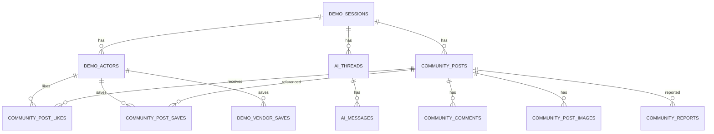

# DB 통합 스키마 — 논리 설계 (미적용)

## 이미 main migration에 존재 (수정/삭제 금지)
- 실제 업체·사용자: `profiles`, `app_private.staff_roles`, `vendors`, `vendor_members`, `vendor_revisions`, `vendor_items`, `item_revisions`, `vendor_images`, `review_events`.
- 시연 조회용: `mvp_synthetic_vendors` (현재 `GET /api/v1/synthetic-vendors` 관련). 이 테이블은 공용 합성 시드로 **방문자별 시연 쓰기 DB가 아님**.
- 관련 RPC: `search_published_vendors`, `get_published_vendor`, `search_mvp_synthetic_vendors`.

## 제안 시연 영역의 논리 엔터티 (물리 테이블명은 제안)

모든 session-scoped 행은 `demo_session_id NOT NULL`과 유효한 소유자 FK, 누락 없는 RLS를 보유해야 한다. 저장 테이블은 `demo_vendor_saves`(업체) + `community_post_saves`(글) **한 벌씩**; 저장 탭을 위한 중복 post 저장 테이블 금지.

## 물리 구현 시 필수 순서
1. **배포 환경/프로젝트 경계** 승인과 시연 주체 Auth 검증.
2. 세션·actor·참조 키 RLS, 서버 키 보관 및 격리 테스트.
3. 커뮤니티 글/댓글/사진/좋아요/신고 및 moderator scope.
4. 저장·AI threads/messages 및 referential integrity.
5. 새 시연 reset/TTL과 Storage 객체 cleanup. 운영 업체/타 세션 영향 0 증명.
6. 성능 인덱스, 시연 환경 migration 수동 승인/적용. main 운영 migration 직접 수정 금지.

개별 컬럼 제안은 `docs/database/{community,ai-assistant,saved}.md` 참고. **정확한 SQL DDL은 작성/적용 전 팀 승인 필요**.
